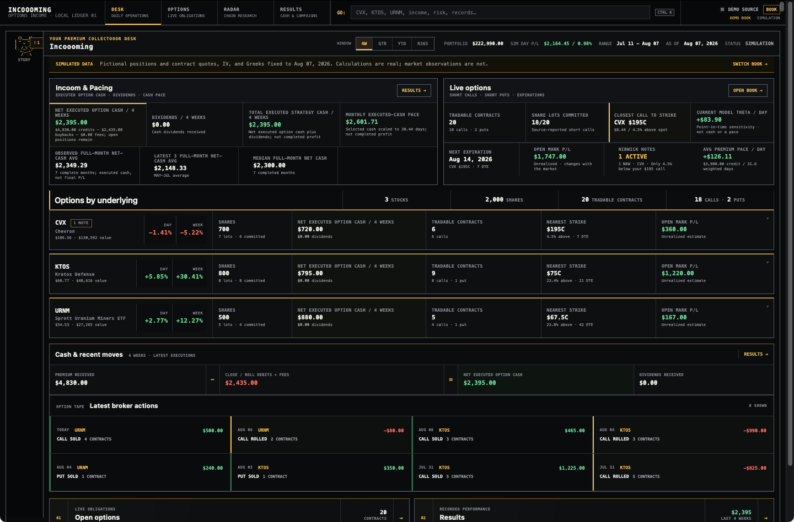
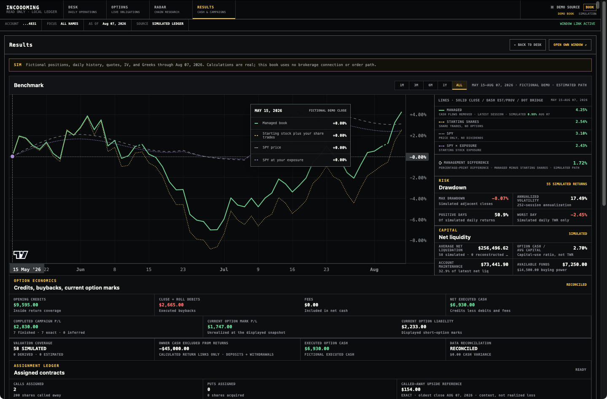

# Incoooming

**Track your covered calls and cash-secured puts. Connect your live Schwab account today.**

I built Incoooming for my own Schwab account. I wanted to see the premium coming in, what was
still at risk, and how the whole account was doing, all in one place. I use it for my own
covered calls and cash-secured puts, and I'm sharing it for anyone who wants that same context.

**[Watch my video walkthrough on X →](https://x.com/ehwwpk/status/2097422524359606668)**

Free and open source. Runs on your computer. Reads data and never places trades.
**Schwab live is available now**, using your own approved Schwab Individual Trader API app.
Other brokers can use supported CSV exports; additional broker logins require a new integration.
Windows and Mac setup guides are below. On Mac, use Chrome for CSV imports.



## What you can see

| View | What it helps you answer |
| --- | --- |
| **Desk** | How much premium came in? What's open, and what's coming up? |
| **Options** | How close are my strikes? What would it cost to close or roll? What risk remains? |
| **Radar** | Which calls or puts fit the rules I chose? Why were other contracts filtered out? |
| **Results** | How is the account doing compared with the same starting shares plus share trades, SPY, and SPY at my starting stock exposure? |

With Schwab connected, you get positions, activity, current quotes, option-chain research, Greeks,
and account comparisons. The app refreshes every 15 minutes while it's running, and you can use
**SYNC NOW** whenever you need a refresh. Quote times and data gaps stay visible.

Just looking around? The demo includes calls, puts, rolls, and the full Results chart. Its data
is fictional and fixed at August 7, 2026. It needs no account or API key; demo Radar only scans
the included example tickers.

<details>
<summary>See the demo's Results chart</summary>



These are made-up returns to show how the comparisons work.

</details>

## Get started

| I want to… | Start here |
| --- | --- |
| **Connect my Schwab account** | [Windows connection guide](docs/getting-started-schwab.md) · [Mac connection guide](docs/getting-started-macos.md#connect-schwab) |
| **Look around first** | Follow the quick setup below and open the demo |
| **Use another broker's exports** | [Import CSV files](#use-another-broker) |
| **Have my coding agent set it up** | [Copy this setup prompt](#want-your-coding-agent-to-help) |

### Quick setup

You'll need **Python 3.12, 3.13, or 3.14**. Supported setups are Windows 10/11 and
**macOS 15 on Apple Silicon and Intel**. See [what we tested on Mac](docs/platforms/macos-validation.md).

1. Get the project with GitHub's **Code → Download ZIP**. On Windows, choose **Extract All**;
   on Mac, double-click the ZIP. Git users can clone the repository instead.
2. Open the extracted folder containing this README and `scripts`. On Windows, type `powershell`
   in File Explorer's address bar and press Enter. On Mac, open Terminal, type `cd `, drag the
   project folder into the Terminal window, and press Enter.
3. Run the setup command for your computer:

**Windows — PowerShell**

```powershell
.\scripts\bootstrap.cmd
```

**Mac — Terminal**

```sh
sh ./scripts/bootstrap.sh
```

4. Once setup finishes, choose your data:

   - **Schwab:** follow the connection guide above to save your app credentials locally and
     authorize access on Schwab's website. You need your own approved developer app; an ordinary
     brokerage login alone isn't enough. You can try the demo or CSV while Schwab approval is pending.
   - **Demo:** run `.\scripts\run-demo.cmd` on Windows or `sh ./scripts/run-demo.sh` on Mac.
   - **CSV or an already connected Schwab account:** run `.\scripts\run-local.cmd` on Windows
     or `sh ./scripts/run-local.sh` on Mac.

Open **[http://127.0.0.1:8182](http://127.0.0.1:8182)** in your browser and choose your data source.
Leave the server terminal open. Press `Ctrl+C` there to stop it before switching between the
standalone demo and your own data.

Need Python, a little more guidance, or help with an error? Follow the
[Windows setup guide](docs/getting-started.md) or [Mac setup guide](docs/getting-started-macos.md).

### Coming back later

Start `run-local.cmd` on Windows or `sh ./scripts/run-local.sh` on Mac after a restart.
If Schwab asks you to sign in again, use `connect-schwab.cmd` or `sh ./scripts/connect-schwab.sh`.
A saved token isn't proof of a fresh sync: check the last successful sync and the dates on Results.
The latest account snapshot and the latest market close can have different dates.

After updating the project, stop the server, back up your local `.env` and `var/` privately, and
rerun bootstrap to update its packages before starting again. Keep those backups out of GitHub.

## Use another broker

**Import CSV files now:** start the normal app with `run-local` as above, then choose
**BOOK → Import CSV**. Select your broker, preview the files, and review any skipped rows before
importing. On Mac, use **Chrome** for CSV imports; Safari file selection remains unverified.
You don't need API credentials for this path.

Recognized exports include Schwab and Fidelity positions/activity, Robinhood activity, Webull
order history, and IBKR Activity Statements. Each format provides different information; an order
history alone won't give you a complete current portfolio. CSV files don't provide live quotes,
option chains, Greeks, or the daily account history needed for the full benchmark chart.
See [supported files and examples](docs/getting-started.md#import-your-own-csv-files).

**Want a live login for another broker?** You or your coding agent can build an adapter using that
broker's approved API. Schwab is the only live broker integration included today; there isn't a
universal broker-login button. Start with [adding a broker](CONTRIBUTING.md#adding-a-broker),
use fictional test data, and keep your credentials private. Contributions are welcome.

## Want your coding agent to help?

Open this project folder in your agent and paste this. Change the chosen source if you'd prefer
CSV or the demo:

```text
Help me get Incoooming running. My chosen source is my live Schwab account.
Read README.md and
the setup guide for my operating system (docs/getting-started.md for Windows,
docs/getting-started-macos.md for Mac). Check the OS and supported Python version,
then install the project dependencies and follow the guide for my chosen source.
For Schwab, check whether I already have an approved developer app. If not, explain
how to request it and set up a working demo or CSV book while approval is pending.
Fix ordinary setup problems as you go.
On Mac, use Chrome for CSV import checks; don't assume Safari uploads are verified.

Let me enter credentials and complete broker login privately;
don't ask me to paste secrets or authorization URLs into chat. Preserve any
existing settings and data, and keep the app on 127.0.0.1. For Schwab, verify a
successful sync, my positions, and the account and market dates on Results. For
CSV or demo, verify the selected book and its available views. Explain any
missing or estimated history; don't treat a saved token as proof of fresh data.
Finish by telling me what worked and the exact command to start it next time.
```

## A few things worth understanding

- **Premium received isn't the same as profit.** An open short option still costs money to close.
  Incoooming shows collected cash, the result of finished option trades, and the estimated result
  of open trades separately.
- **Returns describe the whole account.** Identified deposits and withdrawals are removed from
  returns. The comparison with starting shares includes share trades; the SPY line is price-only,
  without dividends. Historical daily account values may be incomplete, especially on first
  connection or after time offline. Reconstructed history is marked as estimated, not as a
  recorded broker close. Check important numbers against your broker.
- **Missing information stays missing.** A dash means a required input is unavailable. Greeks are
  model estimates, and a roll quote is an estimate of both legs, not a guaranteed fill.
- **Your records stay local.** The app contacts Schwab for authorization and data, then stores
  your records on your computer. Keep `.env`, `var/`, broker exports, logs, and authorization links
  private. Run it locally; don't expose the server through a public link or tunnel.

For the details behind a number, open its method notes or read
[How the numbers work](docs/accounting.md). Incoooming isn't investment or tax advice and has no
affiliation with Charles Schwab or the other brokers listed here.

## Feedback and contributions

Found something confusing or a number that looks wrong? Open an issue with the steps to reproduce
it and whether you used Demo, CSV, or Schwab. Use made-up examples and remove private details from
screenshots. Report security concerns through [SECURITY.md](SECURITY.md).

See [CONTRIBUTING.md](CONTRIBUTING.md) for development setup and checks, or browse the
[documentation](docs/README.md). The project uses the [MIT License](LICENSE);
bundled libraries are listed in [Third-party notices](THIRD_PARTY_NOTICES.md).
